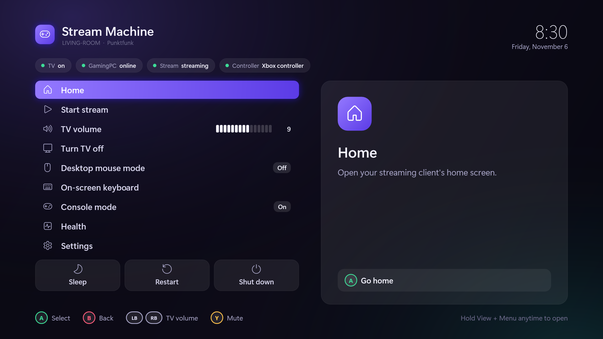
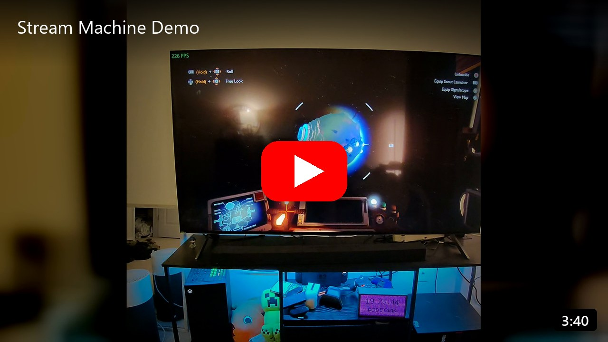
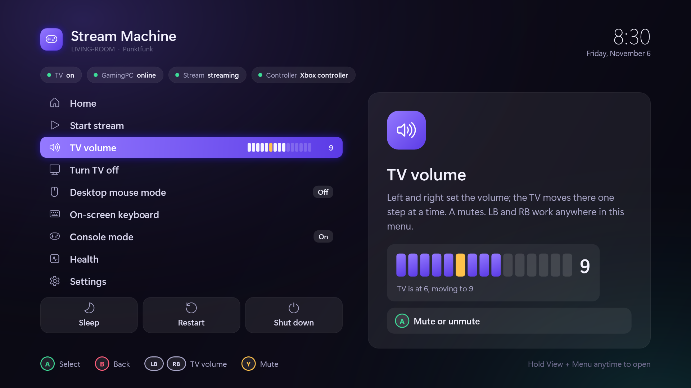
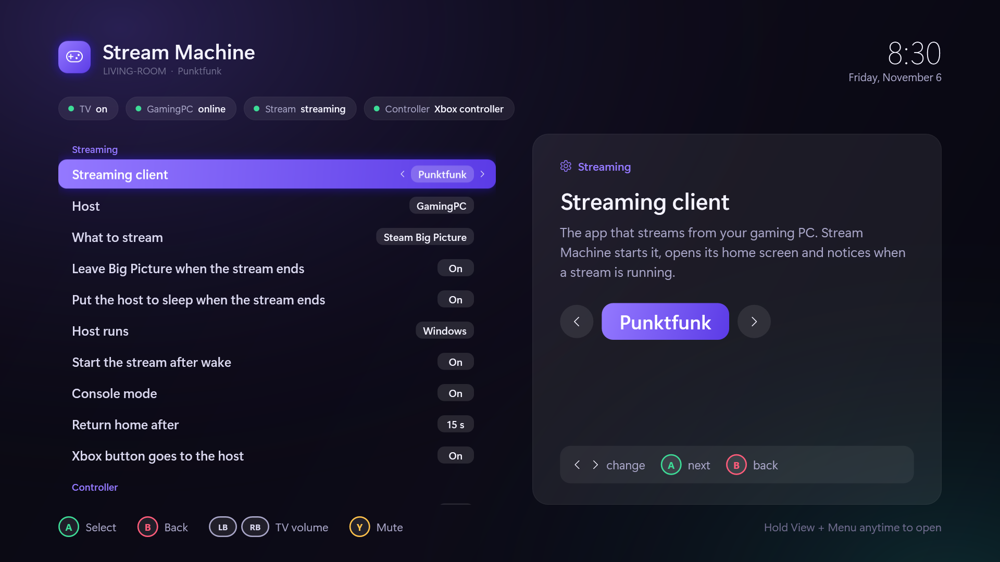
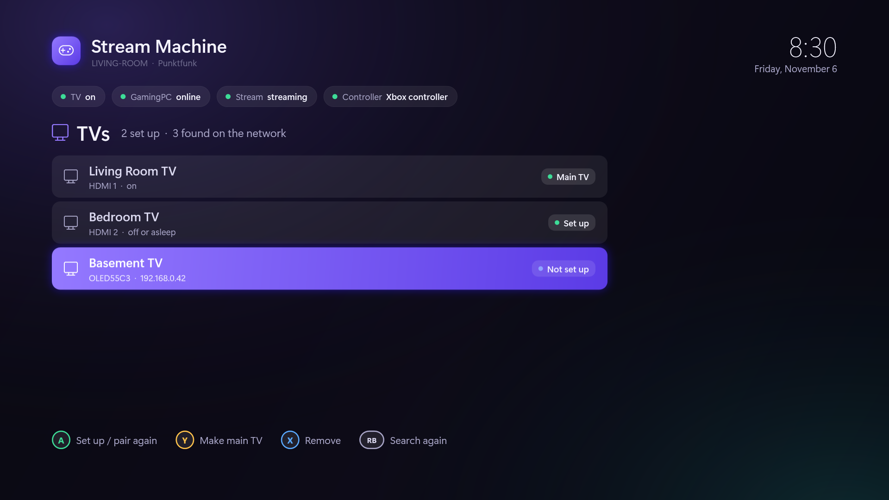
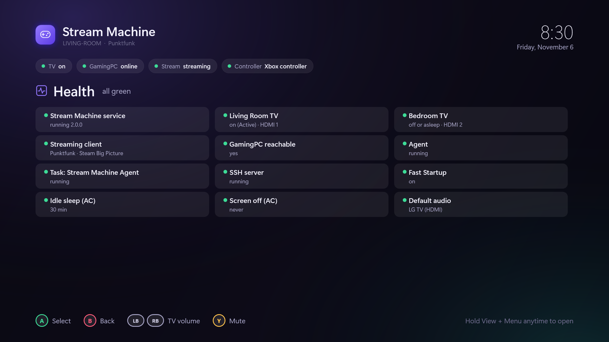

<div align="center">

# Stream Machine

**Turn the PC under your TV into a game-streaming console you run from the couch with a controller.**<br>
A lightweight **Bazzite alternative that keeps Windows**, and on Linux it runs on top of the distro you already have.

[](https://github.com/JMS1717/stream-machine/releases)
[](LICENSE)

-f4bc00?logo=linux&logoColor=white)
[](https://www.paypal.com/paypalme/jasonselsley)



</div>

You have a gaming PC somewhere in the house and a small PC under the TV that streams from it (with
[Punktfunk](https://punktfunk.unom.io), [Moonlight](https://moonlight-stream.org) or Parsec). Stream Machine makes that small PC behave like a
console. The TV turns on with it and off with it, the stream starts when you pick up the controller, and everything else
lives in a menu you open by **holding the Xbox button**. You don't need a keyboard, a mouse or the TV remote.

<div align="center">
<a href="https://www.youtube.com/watch?v=cAKFC2R1WS4"></a><br>
<sub>Every feature on a real TV, start to finish. Click to watch on YouTube.</sub>
</div>

## Why I built this

I built Stream Machine for my own house. There's one gaming PC, and I wanted to play it from any room with a TV
without buying a console for every room or walking over to the PC whenever something needed a click. Each TV gets a
small, cheap PC that streams from the gaming PC, and Stream Machine makes that little PC feel like a console. I use it
every day and I love it.

## Why it's so good now: PyroWave

Streaming used to be the weak link. Codecs built for the internet spend their effort saving bandwidth, and that costs
latency and image quality. [PyroWave](https://github.com/Themaister/pyrowave) flips that around. It's a game-streaming
codec by Themaister that compresses every frame on its own, entirely on the GPU, and spends bandwidth (100+ Mbit/s)
to keep latency as low as possible. Inside a house there's bandwidth to spare, and over a wired network the stream feels like
the TV is plugged straight into the gaming PC. That's what turned multi-room gaming from "good enough" into something I'd
pick over sitting at the desk.

**My recommendation: [Punktfunk](https://punktfunk.unom.io) with PyroWave**, over Ethernet if you can. Punktfunk
bundles PyroWave, and Stream Machine knows how to start it, end it and pass the Xbox button through. You don't have to
use it, though: Moonlight, Parsec, or anything you can start from a command line works too. You choose in Settings.

## Why not just install Bazzite?

[Bazzite](https://bazzite.gg) is great if you want a whole new operating system. Stream Machine is for everyone else:

|  | Bazzite | Stream Machine |
|---|---|---|
| What it is | A Linux distribution that replaces your OS | Two small programs on the OS you already have |
| Windows | No | **Yes**: keep Game Pass, anti-cheat games, your apps and remote tools |
| Linux | Yes | Yes (any systemd distro, **including Bazzite**) |
| TV turns on and off with the PC | Via HDMI-CEC, where the PC supports it | **Yes, over the network** (LG webOS), even with no CEC |
| Controller menu over the stream | Steam Game Mode | **Yes** (Windows): sleep, TV volume, reconnect, mouse mode… |
| Install | Reinstall the PC | **One line**, and one line to remove |

## Highlights

**Your TV follows your PC**
- **On at boot and wake, off at sleep and shutdown.** A restart leaves it on, because it's coming straight back. This works with Windows Fast Startup too.
- **Off in about 65 ms** when the PC sleeps. A kept-open connection to the TV makes it fit easily in the ~2 s Windows allows.
- **Switches to the right HDMI input** and wakes the TV with Wake-on-LAN, even from deep standby.
- **Several TVs**: find, pair (one "Allow" on each TV), choose the main one, and set each one's input and on/off rules.
- **Optional: turn the TV on with its remote, and the PC wakes too** (rooted LG TVs, [see below](#optional-the-tv-wakes-the-pc)).

**A console menu for your controller** (Windows)
- **Hold the Xbox button** (0.4 s) or **View + Menu** to open it over anything, including a full-screen stream. A short buzz confirms it.
- **TV volume slider**: set a target from 1 to 15 and the TV walks there one step at a time, like holding the remote's button. LB/RB work anywhere in the menu.
- **Sleep, Restart, Shut down** (the last two need A twice), **Turn TV off**, **Start stream**, **Home**.
- **Desktop mouse mode**: the left stick moves the pointer, A/B click, the right stick scrolls and Y opens the keyboard. Handy for the occasional Windows dialog.
- **Health page**: TVs, host, service and Windows settings at a glance.
- Reads **XInput (with the Guide button), Windows.Gaming.Input and raw HID**, so most pads work, including D-input ones. It works while another app has focus, and controllers can be plugged in at any time.

**Streaming that just happens**
- **Wake the PC and the stream starts.** The client's home screen opens underneath, so ending a stream lands you back there and not on the desktop.
- **When you disconnect, it leaves Steam Big Picture on the host**, so the host's desktop is back to normal. **Optionally, it puts the host to sleep** 10 s later.
- **Console mode**: if neither a stream nor the client is running, the client reopens after 15 s.
- **Works with Punktfunk, Moonlight and Parsec, or any client** through custom commands. Hosts and apps are picked in Settings.
- **Your choice of where the Xbox button goes** while streaming: to the host (Steam's menu), or kept on this PC.
- **The controller keeps the PC awake**, so the idle sleep timer never fires mid-game.

**Built to be left alone**
- A small Windows service (or systemd unit) plus a per-user agent. Both are self-contained, so there's nothing to install first.
- Locked down: the service only talks to SYSTEM/root and you, only on this machine, and only through a fixed list of commands.
- Everything the installer changes is recorded and put back by the uninstaller.
- Logs rotate. There's no telemetry, and nothing leaves your network.

<div align="center">




</div>

## Quick start

### What you need
- **An LG webOS TV** on the same network as the PC (most LG TVs from 2016 on). On the TV, turn on **Settings → General → Devices → TV Management → Turn on via Wi-Fi** (the name varies by model: *Mobile TV On*, *Wake on LAN*), so the PC can wake it.
- **A streaming client** on the TV PC (Punktfunk, Moonlight, Parsec, or anything you can start from a command line), already paired with your gaming PC.
- Windows 10/11 x64, or a 64-bit systemd Linux.

### Windows
Open PowerShell and paste:
```powershell
irm https://github.com/JMS1717/stream-machine/releases/latest/download/install.ps1 | iex
```
Or download **StreamMachine-windows-x64.zip** from [Releases](https://github.com/JMS1717/stream-machine/releases), unzip it and double-click **Install.cmd**.

Windows asks once for administrator rights. Then the setup wizard finds your TVs (turn them on first), pairs them (press **Allow** on each TV) and asks which streaming client and host to use. That's it: hold the Xbox button.

### Linux (beta)
```bash
curl -fsSL https://github.com/JMS1717/stream-machine/releases/latest/download/install.sh | bash
```
Or extract **stream-machine-linux-x64.tar.gz** and run `./install.sh`. It works on immutable distros such as Bazzite and Fedora Atomic. On Linux you get the TV automation, the `streammachine` command and the stream-after-wake agent. The controller menu is Windows-only for now; in Steam Game Mode, Steam's own menu covers that.

> Linux support is new and hasn't been tested on many machines yet. Reports are welcome in Issues.

## Using it

| Controller | What it does |
|---|---|
| **Hold the Xbox button** (0.4 s) | Open the menu (a quick tap still goes to the host) |
| **Hold View + Menu** (1 s) | Open the menu |
| D-pad / left stick, **A**, **B** | Move, select, back / close |
| **LB / RB** | TV volume down / up (anywhere in the menu) |
| **Y** | Mute the TV |

**Settings** (in the menu) save as soon as you change them:

| Section | Settings |
|---|---|
| Streaming | Client (Punktfunk, Moonlight, Parsec, Custom) · Host · Big Picture or desktop · **Leave Big Picture when the stream ends** · **Put the host to sleep when the stream ends** · Host runs Windows/Linux · Start the stream after wake · Console mode · Return home after · Xbox button goes to the host |
| Controller | Hold Xbox button for the menu · Xbox button hold time · View + Menu hold time · Rumble · Mouse-mode pointer and scroll speed |
| TV | **Set up TVs** (find, pair, main TV, remove) · Which TV the next settings are for · Turn on at startup / after sleep · Turn off at sleep / at shut down · PC's HDMI input · Volume slider range · Volume change speed |
| Power and menu | Sleep when idle · Controller keeps the PC awake · Close the menu after |

### Command line (Windows and Linux)
```text
streammachine setup                 find and pair TVs, choose the streaming client
streammachine status                service, TVs, last power events
streammachine tv scan | pair N | list | primary N | remove N | on | off
streammachine volume up|down|mute|get | volume 9
streammachine set tv-input hdmi2 1  (also tv-on-boot, tv-on-wake, tv-off-sleep, tv-off-shutdown, idle-sleep, volume-speed)
streammachine client moonlight --host GamingPC --app desktop --sleep-host on --host-os windows
streammachine stream | sleep
```

## Putting the host to sleep when you disconnect

Turn on **Settings → Streaming → Put the host to sleep when the stream ends**. Stream Machine waits 10 s (in case you're
just reconnecting), then runs the sleep command on the host over SSH, so the host needs **SSH key login from the TV PC**:

1. On the host, enable the SSH server. On Windows that's *Settings → System → Optional features → OpenSSH Server*. A Windows host should also run `powercfg /h off`, so the sleep command sleeps instead of hibernating.
2. On the TV PC: `ssh-keygen -t ed25519`, then add the public key to the host (`~/.ssh/authorized_keys`, or `C:\ProgramData\ssh\administrators_authorized_keys` for an admin account on Windows).
3. Check `ssh GamingPC` logs in without a password. Done. For a different sleep command, use `streammachine client --host-sleep-command "…"`.

Your streaming client wakes the host again the next time you start a stream (Punktfunk and Moonlight both send Wake-on-LAN).

## Optional: the TV wakes the PC

Most 2.4 GHz controller dongles can't wake a sleeping PC. If your LG TV is rooted (Homebrew Channel with SSH), it can do
the job: `install-tv-hook.ps1 -TvIp <the TV's address>` adds a small script to the TV that sends Wake-on-LAN to the PC
whenever the TV turns on. **Power the TV on with its remote, and the PC wakes and the stream starts.** It uses SSH key
login only, writes only to `/home/root/streammachine` and the Homebrew Channel's `init.d` folder, and
`uninstall-tv-hook.ps1` removes it.

## How it works

| Piece | Runs as | Does |
|---|---|---|
| **Service** (`StreamMachine.Service` / `stream-machine-service`) | Windows service (LocalSystem) / systemd unit (root) | Keeps your TVs in step with the PC's power. On Windows it uses preshutdown, power and event-log signals. On Linux it uses logind's PrepareForSleep/PrepareForShutdown with a short "delay" inhibitor lock. It owns the pairing keys and a control channel: `\\.\pipe\StreamMachine` (SYSTEM + you) or `/run/stream-machine/control.sock` (group `stream-machine`). |
| **Agent** (`StreamMachine.Agent`, Windows) | You, at sign-in (not elevated) | The controller menu, wake flow, console mode, stream-end actions and mouse mode |
| **`streammachine`** | You | Setup wizard and command line; on Linux it's also the stream-after-wake agent |

TVs are controlled the way LG's own phone app does it: the webOS "second screen" websocket, paired once per TV. TVs are
found by MAC address, so a new DHCP address doesn't matter.

## FAQ

**Does it change my streaming client's quality settings?** No. The one thing it can change is Punktfunk's
"system buttons" (whether the Xbox button goes to the host), and only when you change that setting.

**Other TV brands?** Only LG webOS for now. The TV code sits behind a small interface; Samsung and Sony are welcome
contributions.

**Do I need to keep a window open?** No. Everything runs in the background and starts at boot and sign-in.

**How do I remove it?** Windows: double-click **Uninstall.cmd** (or run `uninstall.ps1`), which also restores what the
installer changed. Linux: `./uninstall.sh` (add `--purge` to forget your TVs).

## Troubleshooting

- **The TV doesn't turn on at boot**: enable *Turn on via Wi-Fi/LAN* on the TV, and keep the TV and PC on the same network (Wi-Fi to Ethernet is fine).
- **Volume says "accept the prompt"**: TVs paired with version 1.0 need one more **Allow** for volume. Press it on the TV with the remote.
- **The menu doesn't open with the Xbox button**: check Settings → Controller → *Hold Xbox button for this menu*, or use View + Menu. Some 8BitDo pads report another button with Guide; that still works.
- **Status and logs**: `streammachine status`. Logs are in `C:\ProgramData\StreamMachine\logs` and `%LOCALAPPDATA%\StreamMachine\logs` on Windows, or `journalctl -u stream-machine` and `~/.config/stream-machine/logs` on Linux.

## Development

```powershell
dotnet test src/StreamMachine.Tests          # 140+ unit tests, including a fake webOS TV
pwsh tests/agent-e2e.ps1                     # drives the real agent with a simulated controller (65 checks + screenshots)
pwsh scripts/package.ps1 -Version 2.0.0      # builds the Windows zip and Linux tarball into dist/
```
`src/`: `StreamMachine.Core` (TV control, discovery, clients, protocol), `.Service`, `.Agent` (WPF), `.Cli`, `.Tests`.
Pull requests are welcome.

## Support

Stream Machine is free and open source (MIT). If it made your couch setup better, you can support development with a
**[donation through PayPal](https://www.paypal.com/paypalme/jasonselsley)**. Thank you!
